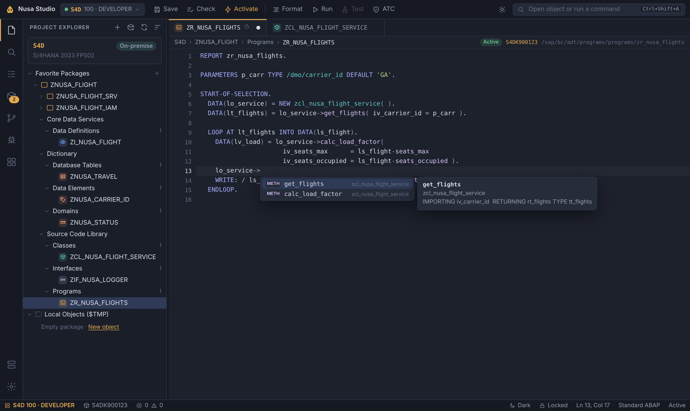
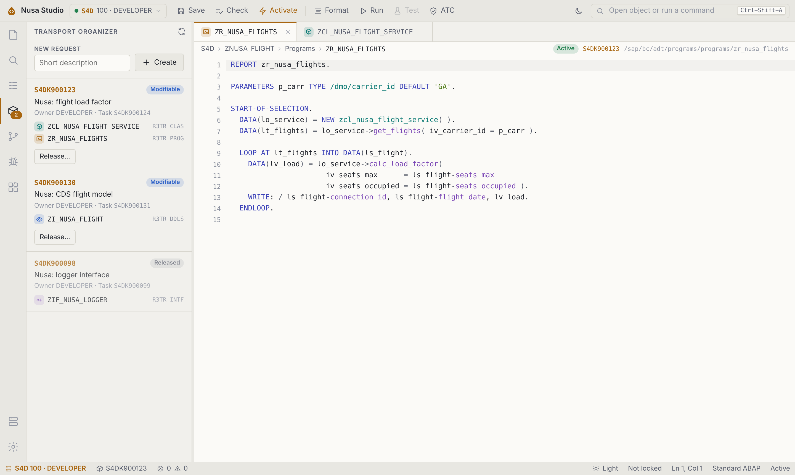
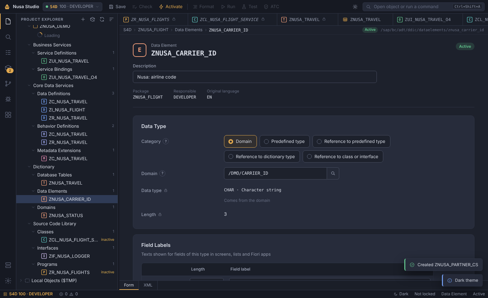
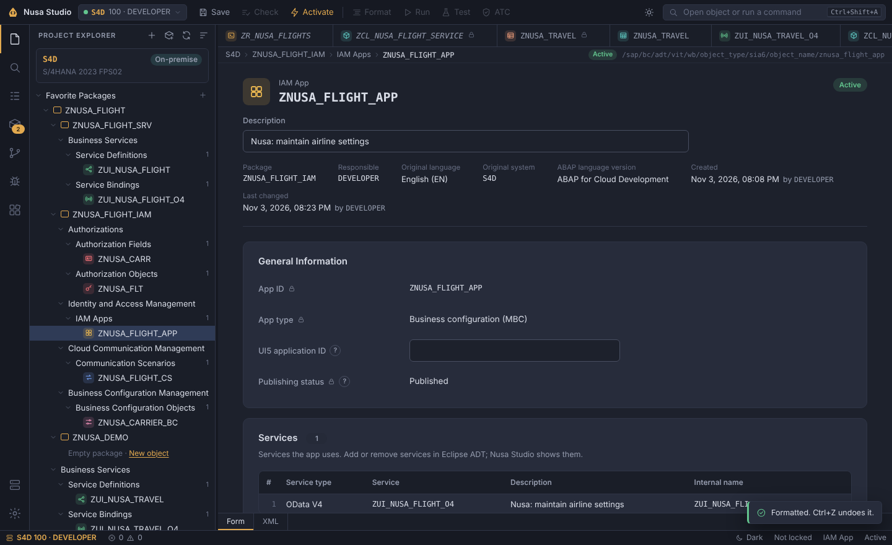
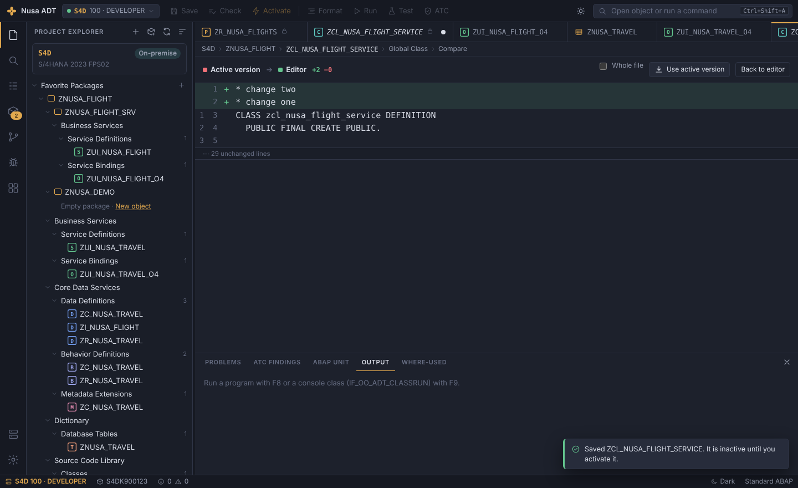
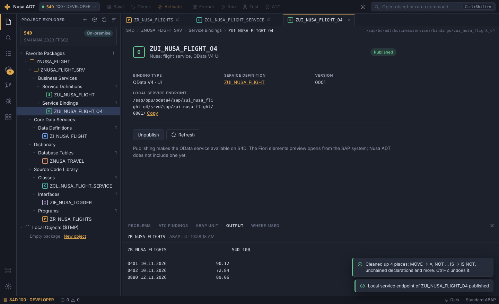
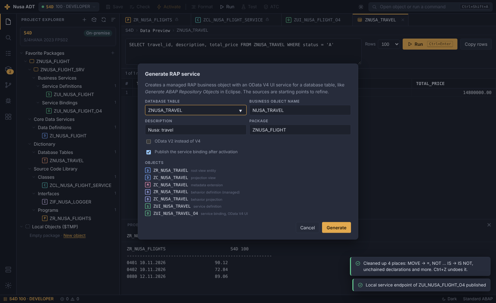
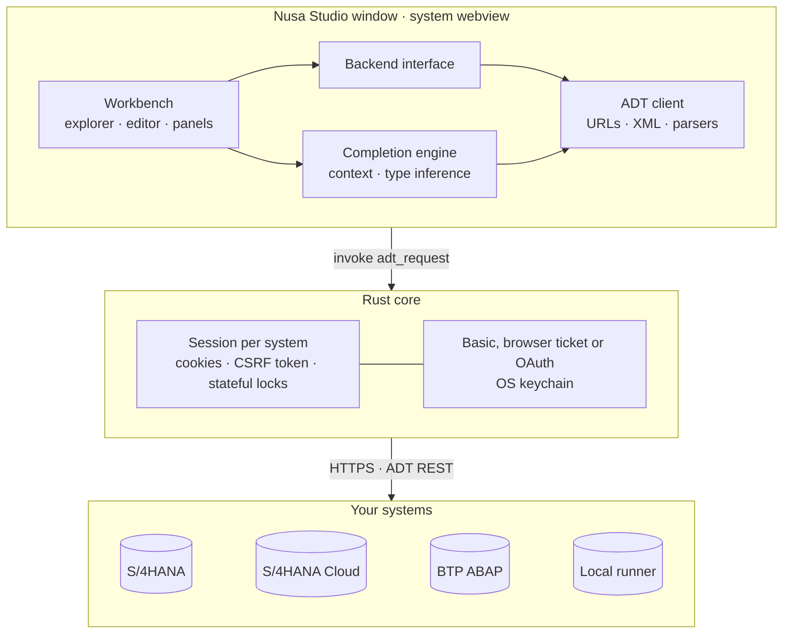

<div align="center">


# Nusa Studio

**A lightweight desktop IDE for ABAP.**
The workflow of Eclipse ADT in a fast, VS Code-style window.


[Download](#download) · [Features](#features) · [Connect to SAP](#connect-to-sap) · [Build from source](#build-from-source) · [Roadmap](#roadmap)

</div>



> **Bahasa Indonesia.** Nusa Studio adalah IDE ABAP ringan dengan tampilan ala VS Code.
> Terhubung ke S/4HANA on-premise, S/4HANA Cloud Public Edition, BTP ABAP Environment, dan ABAP runner lokal lewat
> layanan ADT REST yang sama dengan Eclipse, jadi tidak ada yang perlu dipasang di sisi SAP.
> Unduh installer di halaman [Releases](../../releases).

---

## Why switch from Eclipse ADT?

Nusa Studio uses the same ADT services as Eclipse, so nothing changes on the SAP side and the Eclipse shortcuts still work. What you get on top:

| | Eclipse ADT | Nusa Studio |
|---|---|---|
| Getting started | Install Eclipse and the ADT plugins, create a workspace and an ABAP project per system | Run the app (or the portable exe), add a system |
| Switching systems | Separate projects in the Project Explorer | One click; every system keeps its own open editors |
| Lost work | Unsaved editors are gone after a crash | Unsaved changes come back as a draft; every save goes into local history |
| Compare | Compare With menu and History view | Compare tab with only the changed lines, one click to restore |
| Editing | Eclipse keys | Eclipse keys plus command palette, multi-cursor (Ctrl+D), move and copy lines |
| Extras | Separate plugins (ABAP Cleaner, abapGit) | Data preview, SQL console, ABAP Cleaner (also on save), RAP generator, abapGit built in |
| When a connection fails | Error dialog, details in the Error Log view | What went wrong, what to do, and diagnostics to copy |
| Footprint | Java runtime | System web view, small installer |

New users see a short *Coming from Eclipse ADT* guide; it is also in the command palette.

Where Eclipse ADT is still ahead: the debugger, refactorings such as rename and extract method, function groups and modules, and the specialised editors of some object types (Nusa Studio shows authorization objects, IAM apps, communication scenarios and similar objects in a generic form). Nusa Studio is a preview and has not been verified against a live system yet (see [Status](#status)), so keep Eclipse at hand for those.

## Features

**Editor**
- ABAP and CDS highlighting, line numbers, bracket matching, comment toggle
- Code completion that understands context: members of inferred types, DDIC fields, SQL clauses, call parameters, function module patterns, CDS annotations and more ([full list](#code-completion))
- Go to definition (F3), element info (F2), ABAP keyword documentation (F1), where-used list
- **Format Document** (`Shift+Alt+F` or `Shift+F1`): block indentation, aligned method parameters and chained declarations, keyword case of your choice; CDS sources are indented by braces. It runs offline and only changes whitespace and keyword case; the system's pretty printer is still available in Settings
- **Preview tabs** like VS Code: a single click opens a temporary tab that the next click replaces; editing or double-clicking keeps it
- Outline of classes, methods, attributes and CDS elements
- VS Code editing: next match with several cursors (`Ctrl+D`), move lines (`Alt+↑/↓`), copy lines (`Shift+Alt+↓`), delete lines (`Ctrl+Shift+K`)
- **Never lose work**: unsaved changes are kept as drafts and restored after a crash or restart; every save goes into local history
- **Compare** with the active version or any local history entry, and restore it with one click
- Optional pretty printer and ABAP Cleaner on save
- Dark, light or follow-system theme, adjustable editor font size

**ADT workflow**
- Project Explorer with favorite packages, subpackages and `$TMP`, object search
- New packages with software component, transport layer and application component value helps
- New objects grouped like Eclipse: classes, interfaces, programs, database tables, CDS data definitions, metadata extensions, access controls, behavior definitions, service definitions and service bindings
- **Authorizations, Identity and Access Management, Cloud Communication Management, Business Configuration Management**, application jobs and dictionary objects: authorization fields and objects, default values and variants, IAM apps, business catalogs and role templates, restriction types and fields, communication scenarios, inbound and outbound services, business configuration objects, data elements, domains, table types, message classes, number range and application log objects. They open in a form editor and save, lock, record in transports and activate like source code
- **Form editors laid out like Eclipse**: data elements (Data Type with category choices, built-in types with their length rules, Field Labels with character counters, Additional Properties with search help, parameter ID and change document) and domains (Format, Output Characteristics, Value Range with fixed values and value table). Other types get the same look, built from the object's own structure; nothing is hidden, and an XML view is always one click away
- **IAM apps laid out like Eclipse**: General Information, services, and authorizations per authorization object with editable values (activities as a choice list). Which fields show and which are locked follows the editor settings the system sends with the app
- An icon for every object type, coloured per family (source code, CDS, dictionary, authorizations, IAM, communication, configuration)
- **Value help** on fields that name repository objects (`Ctrl+Space` or the search button): domains, data elements, tables, search helps, parameters, classes, authorization objects and more, searched in the connected system
- Any other object type in a package is listed with the system's own folder name and can be viewed
- Service binding editor with **Publish / Unpublish** for OData V2 and V4, and the service URL
- Lock, save inactive, activate, activate all inactive objects, delete objects
- Class includes in tabs: global class, local types, test classes
- Transport Organizer: choose or create a request on save, release requests

**Quality and running**
- Syntax check with problems panel and inline markers
- ABAP Unit with pass/fail per method and jump to the failing line
- ATC findings grouped by priority
- Run console classes (`IF_OO_ADT_CLASSRUN`) and, on the local runner, reports
- Debugger with breakpoints, step into/over/return, variables and call stack (experimental on SAP systems)

**Built-in extensions** (switch each on or off in the Extensions view)
- **Data Preview & SQL Console**: F8 on a table or CDS view shows its rows; run ABAP SQL with `Ctrl+Enter`
- **ABAP Cleaner** (`Ctrl+4`): MOVE, CREATE OBJECT, CALL METHOD, EQ/NE, NOT … IS, TRANSLATE, chained and aligned declarations, keyword case; each rule can be turned off in Settings
- **RAP Generator**: right-click a table to generate root and projection views, metadata extension, both behavior definitions, service definition and an OData V4 (or V2) binding, then activate and publish them
- **abapGit**: link a package to a Git repository, pull and unlink
- **Keyword documentation and element info**: F1 and F2 at the cursor
- **Outline** of the open object

**When something goes wrong**
- Error pages that say what failed and offer the next step (try again, log in again, edit the system, open DEMO)
- A connection log per system with **Copy diagnostics**; passwords, tickets and tokens are never recorded

**Built to stay light**
- Tauri 2 app using the system webview: small installer, low memory
- Passwords and BTP service keys in the OS keychain, never in files
- Command palette for every action, keyboard shortcuts matching Eclipse ADT

<details>
<summary><b>Light theme and Transport Organizer</b></summary>



</details>

<details>
<summary><b>Data element laid out like Eclipse</b></summary>



</details>

<details>
<summary><b>IAM app in the form editor</b></summary>



</details>

<details>
<summary><b>Compare with the active version</b></summary>



</details>

<details>
<summary><b>Service binding with Publish, and the RAP generator</b></summary>





</details>

### Supported systems

| | S/4HANA / NetWeaver | S/4HANA Cloud Public | BTP ABAP Environment | Local runner |
|---|:---:|:---:|:---:|:---:|
| Explorer, editor, save, activate | ✓ | ✓ | ✓ | ✓ |
| Completion from the system's repository | ✓ | ✓ released objects | ✓ released objects | ✓ |
| Packages, CDS, RAP objects, service bindings | ✓ | ✓ | ✓ | – |
| Syntax check, pretty printer, ABAP Cleaner | ✓ | ✓ | ✓ | ✓ local |
| Transports | ✓ | ✓ | ✓ | not needed |
| ABAP Unit, ATC | ✓ | ✓ | ✓ | unit if served |
| Data preview, SQL console | ✓ | ✓ | ✓ | – |
| abapGit | recent releases | ✓ | ✓ | – |
| Run console class | ✓ | ✓ | ✓ | ✓ |
| Run report with list output | SAP GUI | – | – | ✓ |
| Debugger | experimental | experimental | experimental | – |
| Login | user and password or browser | browser (SSO) | service key or browser | none |

## Download

Every [release](../../releases) has two kinds of downloads:

| | Install | Portable (no install, just run) |
|---|---|---|
| Windows 10/11 | `Nusa.Studio_x.y.z_x64-setup.exe` or `.msi` | `Nusa-Studio-x.y.z-portable-x64.exe` |
| macOS 11+ | `.dmg` | `Nusa-Studio-x.y.z-portable-macos.zip` |
| Linux | `.deb` | `Nusa-Studio-x.y.z-portable-x86_64.AppImage` |

The portable Windows build is a single `.exe`: put it anywhere (Downloads, a USB stick) and double-click. It keeps its system list in a `nusa-adt-data` folder next to the file; passwords stay in the Windows Credential Manager. It needs the Microsoft Edge WebView2 runtime, which Windows 10 and 11 already include.

The builds are not code-signed yet:

- **Windows**: SmartScreen asks once. Click **More info → Run anyway**.
- **macOS**: unzip, then right-click **Nusa Studio** and choose **Open** the first time. On macOS 15, use **System Settings → Privacy & Security → Open Anyway**.
- **Linux**: `chmod +x Nusa-Studio-*.AppImage` and run it.

To build everything yourself, open **Actions → Build desktop app → Run workflow**. A quick `rust` job compiles and tests the Rust core first, so a compile error shows up within minutes. A draft release with all files appears after 15–25 minutes. The same files are also attached to the workflow run under **Artifacts**, together with `Cargo.lock`; commit that file to `src-tauri/` so later builds use the same crate versions.

## Connect to SAP

The app starts on the built-in **DEMO** system: sample classes, a report, a CDS view and transports, so you can try every feature without SAP. Changes there stay on your computer; **Reset DEMO System** in the command palette restores the samples.

To work on a real system, open **Systems** (the server icon at the bottom of the left rail) and add one:

| Type | What to enter |
|---|---|
| **S/4HANA or NetWeaver** | URL such as `https://host:44300` (HTTPS port from transaction `SMICM` → Services), client and user. The password is asked once and kept in the keychain. Systems with SAML or Kerberos can use *Browser logon* instead. |
| **S/4HANA Cloud Public Edition** | The address of the developer extensibility system as you open it in the browser, such as `https://my123456.s4hana.cloud.sap` (a launchpad link with `/ui#Shell-home` works too, and so does the `-api` URL). The browser opens and you log on as in the Fiori launchpad; Nusa Studio then works against `my123456-api.s4hana.cloud.sap`. While it waits, the window shows the logon link with **Copy link**, **Open again** and **Cancel**, so you can use another browser or profile. |
| **BTP ABAP Environment** | Either the service key JSON (OAuth, the token refreshes on its own) or just the system URL, such as `https://<id>.abap.eu10.hana.ondemand.com`, with *Browser logon*. |
| **Local runner** | The runner's URL, for example `http://localhost:7777`. See [docs/RUNNER-PROTOCOL.md](docs/RUNNER-PROTOCOL.md). |

On the SAP side, the ICF services under `/sap/bc/adt` must be active (`SICF`) and the user needs the same authorizations as for Eclipse ADT. On S/4HANA Cloud and BTP that means a business role with the **Developer** catalog (`SAP_BR_DEVELOPER`); without it, logon succeeds but every request returns 401, and Nusa Studio says so. If logon expires, use **Log in again** on the system in the Systems view. If Eclipse ADT already works with the system, Nusa Studio will too. For development systems with self-signed certificates, tick *Accept a self-signed certificate*.

## How it works



The UI never talks to SAP directly. The Rust core keeps two cookie jars per system, one stateless and one stateful, because ADT enqueue locks live in the stateful session between LOCK, PUT and UNLOCK. It also fetches and refreshes CSRF tokens and handles login. For browser logon it opens `/sap/bc/sec/reentrance` on the system's UI host in your browser, receives a reentrance ticket on a local port and exchanges it for a session on the API host (`MYSAPSSO2` header with `x-sap-security-session: create`), the same flow SAP Fiori tools use.

## Build from source

<details>
<summary><b>Prerequisites</b> (once per machine)</summary>

All platforms need [Node.js](https://nodejs.org) 20 or newer and [Rust](https://rustup.rs).

- **Windows 10/11**: Microsoft C++ Build Tools with *Desktop development with C++*. WebView2 is already installed.
- **macOS**: `xcode-select --install`
- **Ubuntu / Debian**:
  ```bash
  sudo apt install libwebkit2gtk-4.1-dev build-essential curl wget file \
    libxdo-dev libssl-dev libayatana-appindicator3-dev librsvg2-dev gnome-keyring
  ```

Details: [Tauri 2 prerequisites](https://v2.tauri.app/start/prerequisites/).

</details>

```bash
npm install
npm run tauri dev      # run the desktop app with hot reload
npm run tauri build    # build the installer into src-tauri/target/release/bundle
```

Other scripts:

| Command | Does |
|---|---|
| `npm test` | unit tests: ABAP analysis, completion contexts, ADT parsers, backends |
| `npm run prototype` | single HTML file with sample systems, no SAP needed |
| `npm run smoke` | headless UI test of the prototype (needs Playwright) |
| `npm run test:ui` | end-to-end UI test with the real CodeMirror editor (needs Playwright) |

## Keyboard shortcuts

| Action | Shortcut | Action | Shortcut |
|---|---|---|---|
| Open object | `Ctrl+Shift+A` | All commands | `Ctrl+Shift+P` |
| New object | `Ctrl+N` | Settings | `Ctrl+,` |
| Save | `Ctrl+S` | Activate | `Ctrl+F3` |
| Activate all inactive | `Ctrl+Shift+F3` | Check syntax | `Ctrl+F2` |
| Format document | `Shift+Alt+F` / `Shift+F1` | ABAP Cleaner | `Ctrl+4` |
| Code completion | `Ctrl+Space` | Element info | `F2` |
| Keyword documentation | `F1` | Go to definition | `F3` |
| Run, data preview | `F8` / `F9` | SQL console | `Ctrl+Alt+F8` |
| ABAP Unit | `Ctrl+Shift+F10` | ATC | `Ctrl+Shift+F2` |
| Where-used | `Ctrl+Shift+G` | Toggle comment | `Ctrl+/` |
| Next match (multi-cursor) | `Ctrl+D` | Delete line | `Ctrl+Shift+K` |
| Move line | `Alt+↑` / `Alt+↓` | Copy line | `Shift+Alt+↓` |
| Toggle breakpoint | `Ctrl+Shift+B` | Dark mode on/off | `Ctrl+Alt+D` |
| Step into / over / return | `F5` / `F6` / `F7` | Resume / stop debugging | `F8` / `Shift+F5` |
| Side bar | `Ctrl+B` | Panel | `Ctrl+J` |

## Code completion

Completion works out where the cursor is, infers variable types from the source, and asks the system's repository for names, fields and signatures (cached per session). On S/4HANA and BTP the server's own proposals are added, so nothing the system offers is lost.

<details>
<summary><b>All contexts</b></summary>

| Where you type | What you get |
|---|---|
| `lo_obj->`, `me->`, `cls=>create( )->` | instance methods and attributes of the inferred class, with call snippets |
| `cls=>`, `if_x=>` | static methods, constants, types |
| `ls_row-`, `sy-`, `ls-a-b` | components of the inferred structure, including rows of `LOOP AT … INTO DATA( )`, `SELECT … INTO TABLE @DATA( )` and method results |
| after `TYPE`, `TABLE OF`, `LIKE`, `REF TO` | built-in, local and class types, data elements, tables, structures, CDS entities, table types, classes |
| `SELECT … FROM`, `JOIN` | database tables and CDS views (released only on ABAP Cloud) |
| SELECT field list, `FIELDS`, `WHERE`, `ORDER BY`, `alias~` | fields of the tables in FROM/JOIN, SQL functions, `@` host variables |
| inside `meth(` or `NEW cls(` | parameter names not used yet, then values after `=` |
| `CALL FUNCTION '…` | function modules with the full call pattern |
| `CATCH`, `RAISING`, `RAISE EXCEPTION` | exception classes |
| `METHOD ` in an implementation | declared methods not yet implemented, including `if_x~method` |
| `LOOP AT`, `READ TABLE`, `SORT … BY`, `WITH KEY` | table variables, next keywords, row components |
| `IF`, `ELSEIF`, `WHILE`, `CHECK` | operands, functions, comparison operators |
| statement start | statements valid in that scope, snippets, variables, own methods |
| `##`, `"#EC`, `<` | pragmas, pseudo comments, field symbols |
| CDS `@` and `#` | annotations with value templates, enum values |
| CDS `from`, `join`, `association … to`, `projection on` | data sources |
| CDS element list, `alias.`, `$projection.`, `abap.`, `cast( … as` | fields, associations, functions, built-in types |

</details>

## Project structure

| Path | Contents |
|---|---|
| `src/ui` | workbench (`app.ts`), editor modes and completion popup (`editor.ts`), styles |
| `src/core` | ABAP analysis and pretty printer, completion engine, reference catalog, ABAP Cleaner, RAP generator, outline, templates, shared types |
| `src/adt` | ADT REST client, XML parser, repository catalog, debugger, Tauri bridge |
| `src/backends` | `adt.ts` for real systems, `mock.ts` for the DEMO system, `router.ts` |
| `src-tauri` | Rust core: commands, HTTP sessions, OAuth and browser logon, connection store |
| `test` | unit tests, in-memory ADT server, UI tests |
| `docs` | runner protocol, screenshots |

## Status

Nusa Studio is a preview. What has been verified so far:

| Area | Status |
|---|---|
| Workbench UI end to end (DEMO system, real editor) | 29 scenarios, including the IAM app layout, the data element and domain forms with value help, preview tabs, collapse all, Format Document, the IAM app form and creating a communication scenario; edit, save, activate, completion while typing, packages, new objects, service binding publish, data preview, RAP generator, ABAP Cleaner, abapGit, compare and local history, draft recovery, multi-cursor and line editing, systems, themes, phone width |
| Desktop shell against an in-memory ADT server | tested: title bar, error pages, save with transport, activate, session restore |
| ABAP analysis, formatter, cleaner, RAP generator, diff, object types, completion contexts | 61 unit tests; the formatter is checked to keep every token of the sample sources |
| ADT response parsing and edit cycle | tested against recorded payload shapes and an in-memory ADT server |
| Rust core | compiled and unit-tested by the `rust` job of the workflow before the installers are built |
| S/4HANA Cloud Public Edition | first checks on a live system: browser logon, package explorer with all object families, class and CDS editing, data element, domain and IAM app forms, service binding and data preview work. Package creation, publishing and abapGit are not checked yet |
| Other live systems | on-premise S/4HANA and BTP ABAP are not checked yet |
| Form-based objects on a live system | not tested yet. They are read and saved as the XML document the system returns. New ones are created by copying the format of an existing object of the same type in that system, so the first object of a type the system has never seen still needs Eclipse |
| Browser logon | redirect to `http://localhost:<port>/adt/redirect`; BTP OAuth needs it allowed by the UAA |

Found something that does not work with your system? Open an issue with the error message and the SAP release.

## Roadmap

- [ ] First verified run against S/4HANA, S/4HANA Cloud and BTP
- [ ] Code signing for Windows and macOS installers
- [ ] CDS formatter and server-side DDL completion
- [ ] Rename and extract-method refactoring
- [x] RAP generator (views, behavior definitions, service binding)
- [x] abapGit pull and link
- [ ] abapGit push and staging
- [ ] Function groups, message classes, data elements and domains
- [ ] Debugger watchpoints and conditional breakpoints

## License

[MIT](LICENSE) · Made by [ABAP Nusantara](https://www.abapnusantara.com)
