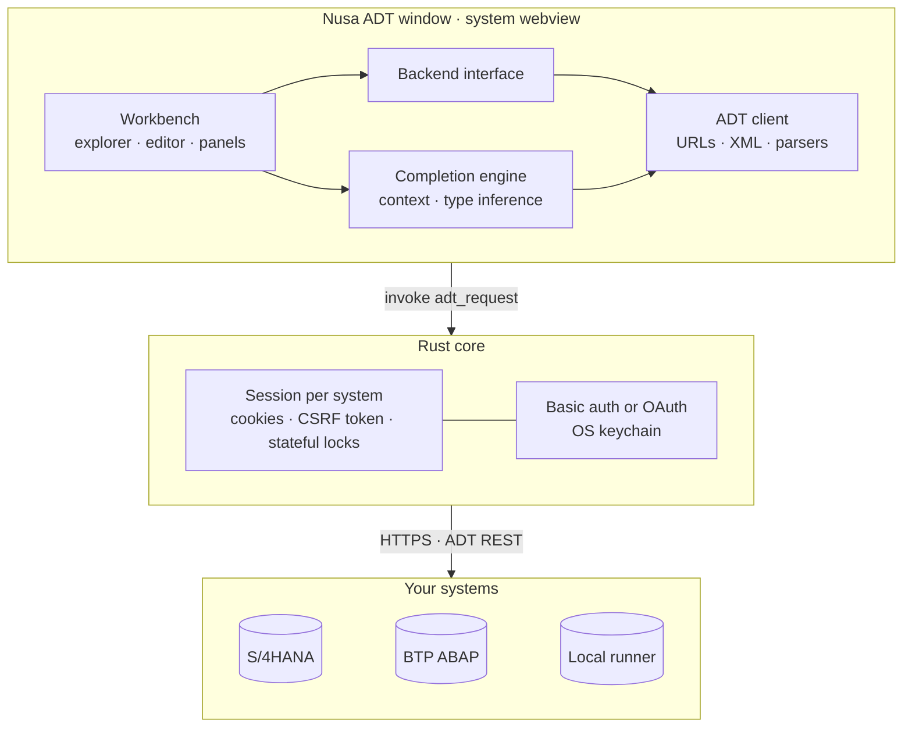

<div align="center">


# Nusa ADT

**A lightweight desktop IDE for ABAP.**
The workflow of Eclipse ADT in a fast, VS Code-style window.


[Download](#download) · [Features](#features) · [Connect to SAP](#connect-to-sap) · [Build from source](#build-from-source) · [Roadmap](#roadmap)

</div>


> **Bahasa Indonesia.** Nusa ADT adalah IDE ABAP ringan dengan tampilan ala VS Code.
> Terhubung ke S/4HANA on-premise, BTP ABAP Environment, dan ABAP runner lokal lewat
> layanan ADT REST yang sama dengan Eclipse, jadi tidak ada yang perlu dipasang di sisi SAP.
> Unduh installer di halaman [Releases](../../releases).

---

## Features

**Editor**
- ABAP and CDS highlighting, line numbers, bracket matching, comment toggle
- Code completion that understands context: members of inferred types, DDIC fields, SQL clauses, call parameters, function module patterns, CDS annotations and more ([full list](#code-completion))
- Go to definition (F3), where-used list, pretty printer
- Dark, light or follow-system theme

**ADT workflow**
- Project Explorer with favorite packages and `$TMP`, object search
- Lock, save inactive, activate, activate all inactive objects
- Class includes in tabs: global class, local types, test classes
- Transport Organizer: choose or create a request on save, release requests
- New objects: classes, interfaces, programs, CDS data definitions

**Quality and running**
- Syntax check with problems panel and inline markers
- ABAP Unit with pass/fail per method and jump to the failing line
- ATC findings grouped by priority
- Run console classes (`IF_OO_ADT_CLASSRUN`) and, on the local runner, reports
- Debugger with breakpoints, step into/over/return, variables and call stack (experimental on SAP systems)

**Built to stay light**
- Tauri 2 app using the system webview: small installer, low memory
- Passwords and BTP service keys in the OS keychain, never in files
- Command palette for every action, keyboard shortcuts matching Eclipse ADT

<details>
<summary><b>Light theme and Transport Organizer</b></summary>


</details>

### Supported systems

| | S/4HANA / NetWeaver | BTP ABAP Environment | Local runner |
|---|:---:|:---:|:---:|
| Explorer, editor, save, activate | ✓ | ✓ | ✓ |
| Completion from the system's repository | ✓ | ✓ released objects | ✓ |
| Syntax check, pretty printer | ✓ | ✓ | ✓ local |
| Transports | ✓ | ✓ | not needed |
| ABAP Unit | ✓ | ✓ | if served |
| ATC | ✓ | ✓ | – |
| Run console class | ✓ | ✓ | ✓ |
| Run report with list output | SAP GUI | – | ✓ |
| Debugger | experimental | experimental | – |
| Login | user and password | browser SSO | none |

## Download

Installers for Windows (`.msi` / `.exe`), macOS (`.dmg`) and Linux (`.deb` / `.AppImage`) are attached to each [release](../../releases).

The builds are not code-signed yet:

- **Windows**: SmartScreen asks once. Click **More info → Run anyway**.
- **macOS**: right-click the app and choose **Open** the first time.

To build the installers yourself, open **Actions → Build desktop app → Run workflow**. A draft release with all three platforms appears after 15–25 minutes.

## Connect to SAP

Open **Systems** (the server icon at the bottom of the left rail) and add a system:

| Type | What to enter |
|---|---|
| **S/4HANA or NetWeaver** | URL such as `https://host:44300` (HTTPS port from transaction `SMICM` → Services), client and user. The password is asked once and kept in the keychain. |
| **BTP ABAP Environment** | The service key JSON of your instance. The browser opens for login on first use; the token refreshes on its own. |
| **Local runner** | The runner's URL, for example `http://localhost:7777`. See [docs/RUNNER-PROTOCOL.md](docs/RUNNER-PROTOCOL.md). |

On the SAP side, the ICF services under `/sap/bc/adt` must be active (`SICF`) and the user needs the same authorizations as for Eclipse ADT. If Eclipse ADT already works with the system, Nusa ADT will too. For development systems with self-signed certificates, tick *Accept a self-signed certificate*.

## How it works



The UI never talks to SAP directly. The Rust core keeps two cookie jars per system, one stateless and one stateful, because ADT enqueue locks live in the stateful session between LOCK, PUT and UNLOCK. It also fetches and refreshes CSRF tokens and handles login.

## Build from source

<details>
<summary><b>Prerequisites</b> (once per machine)</summary>

All platforms need [Node.js](https://nodejs.org) 20 or newer and [Rust](https://rustup.rs).

- **Windows 10/11**: Microsoft C++ Build Tools with *Desktop development with C++*. WebView2 is already installed.
- **macOS**: `xcode-select --install`
- **Ubuntu / Debian**:
  ```bash
  sudo apt install libwebkit2gtk-4.1-dev build-essential curl wget file \
    libxdo-dev libssl-dev libayatana-appindicator3-dev librsvg2-dev gnome-keyring
  ```

Details: [Tauri 2 prerequisites](https://v2.tauri.app/start/prerequisites/).

</details>

```bash
npm install
npm run tauri dev      # run the desktop app with hot reload
npm run tauri build    # build the installer into src-tauri/target/release/bundle
```

Other scripts:

| Command | Does |
|---|---|
| `npm test` | unit tests: ABAP analysis, completion contexts, ADT parsers, backends |
| `npm run prototype` | single HTML file with sample systems, no SAP needed |
| `npm run smoke` | headless UI test of the prototype (needs Playwright) |

## Keyboard shortcuts

| Action | Shortcut | Action | Shortcut |
|---|---|---|---|
| Open object | `Ctrl+Shift+A` | All commands | `Ctrl+Shift+P` or `F1` |
| Save | `Ctrl+S` | Activate | `Ctrl+F3` |
| Activate all inactive | `Ctrl+Shift+F3` | Check syntax | `Ctrl+F2` |
| Pretty printer | `Shift+F1` | Code completion | `Ctrl+Space` |
| Run | `F8` / `F9` | ABAP Unit | `Ctrl+Shift+F10` |
| ATC | `Ctrl+Shift+F2` | Where-used | `Ctrl+Shift+G` |
| Go to definition | `F3` | Toggle comment | `Ctrl+/` |
| Toggle breakpoint | `Ctrl+Shift+B` | Dark mode on/off | `Ctrl+Alt+D` |
| Step into / over / return | `F5` / `F6` / `F7` | Resume / stop debugging | `F8` / `Shift+F5` |
| Side bar | `Ctrl+B` | Panel | `Ctrl+J` |

## Code completion

Completion works out where the cursor is, infers variable types from the source, and asks the system's repository for names, fields and signatures (cached per session). On S/4HANA and BTP the server's own proposals are added, so nothing the system offers is lost.

<details>
<summary><b>All contexts</b></summary>

| Where you type | What you get |
|---|---|
| `lo_obj->`, `me->`, `cls=>create( )->` | instance methods and attributes of the inferred class, with call snippets |
| `cls=>`, `if_x=>` | static methods, constants, types |
| `ls_row-`, `sy-`, `ls-a-b` | components of the inferred structure, including rows of `LOOP AT … INTO DATA( )`, `SELECT … INTO TABLE @DATA( )` and method results |
| after `TYPE`, `TABLE OF`, `LIKE`, `REF TO` | built-in, local and class types, data elements, tables, structures, CDS entities, table types, classes |
| `SELECT … FROM`, `JOIN` | database tables and CDS views (released only on ABAP Cloud) |
| SELECT field list, `FIELDS`, `WHERE`, `ORDER BY`, `alias~` | fields of the tables in FROM/JOIN, SQL functions, `@` host variables |
| inside `meth(` or `NEW cls(` | parameter names not used yet, then values after `=` |
| `CALL FUNCTION '…` | function modules with the full call pattern |
| `CATCH`, `RAISING`, `RAISE EXCEPTION` | exception classes |
| `METHOD ` in an implementation | declared methods not yet implemented, including `if_x~method` |
| `LOOP AT`, `READ TABLE`, `SORT … BY`, `WITH KEY` | table variables, next keywords, row components |
| `IF`, `ELSEIF`, `WHILE`, `CHECK` | operands, functions, comparison operators |
| statement start | statements valid in that scope, snippets, variables, own methods |
| `##`, `"#EC`, `<` | pragmas, pseudo comments, field symbols |
| CDS `@` and `#` | annotations with value templates, enum values |
| CDS `from`, `join`, `association … to`, `projection on` | data sources |
| CDS element list, `alias.`, `$projection.`, `abap.`, `cast( … as` | fields, associations, functions, built-in types |

</details>

## Project structure

| Path | Contents |
|---|---|
| `src/ui` | workbench (`app.ts`), editor modes and completion popup (`editor.ts`), styles |
| `src/core` | ABAP analysis and pretty printer, completion engine, reference catalog, shared types |
| `src/adt` | ADT REST client, XML parser, repository catalog, debugger, Tauri bridge |
| `src/backends` | `adt.ts` for real systems, `mock.ts` for the prototype |
| `src-tauri` | Rust core: commands, HTTP sessions, OAuth login, connection store |
| `test` | unit tests, in-memory ADT server, UI smoke test |
| `docs` | runner protocol, screenshots |

## Status

Nusa ADT is a preview. What has been verified so far:

| Area | Status |
|---|---|
| Workbench UI end to end (prototype) | tested: edit, save, activate, includes, transports, ABAP Unit, debugger, themes, completion, phone width |
| ABAP analysis, pretty printer, completion contexts | 40 unit tests |
| ADT response parsing and edit cycle | tested against recorded payload shapes and an in-memory ADT server |
| Rust core | written and format-checked; first compile happens in the release workflow |
| Live SAP systems | not tested yet. Object creation, ATC, where-used and the debugger may need payload adjustments |
| BTP login | redirect to `http://localhost:<port>/adt/redirect` must be allowed by the UAA |

Found something that does not work with your system? Open an issue with the error message and the SAP release.

## Roadmap

- [ ] First verified run against S/4HANA and BTP
- [ ] Code signing for Windows and macOS installers
- [ ] CDS formatter and server-side DDL completion
- [ ] Rename and extract-method refactoring
- [ ] RAP generator (behavior definition, service binding)
- [ ] abapGit integration
- [ ] Debugger watchpoints and conditional breakpoints

## License

[MIT](LICENSE) · Made by [ABAP Nusantara](https://www.abapnusantara.com)
